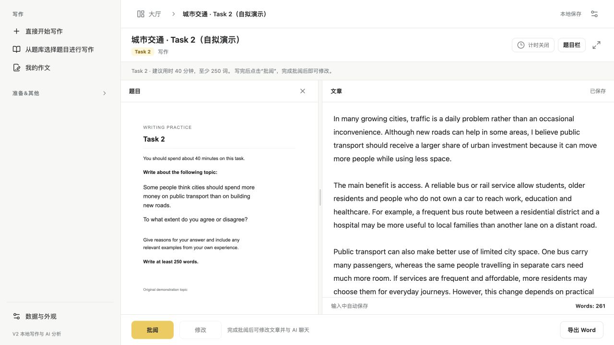
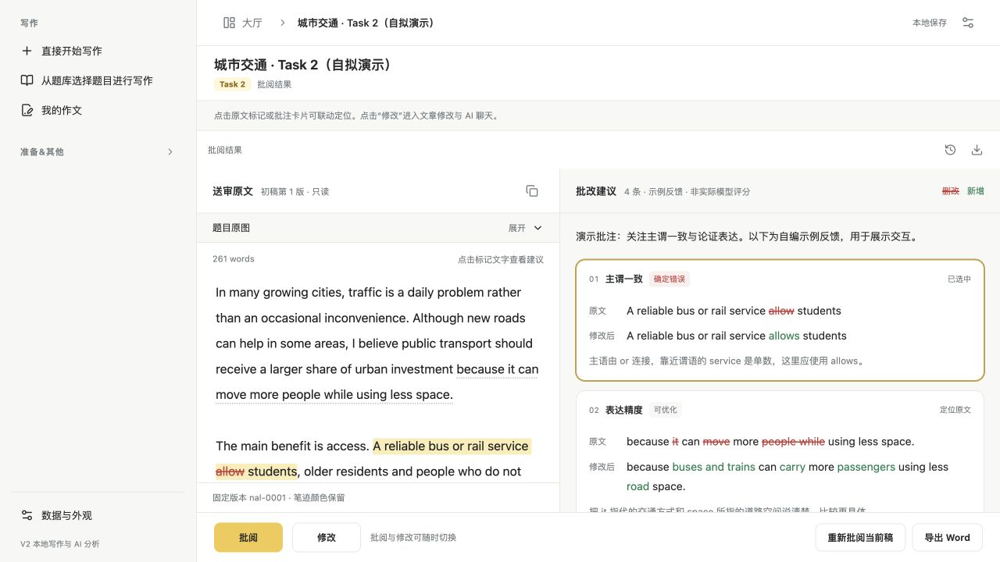
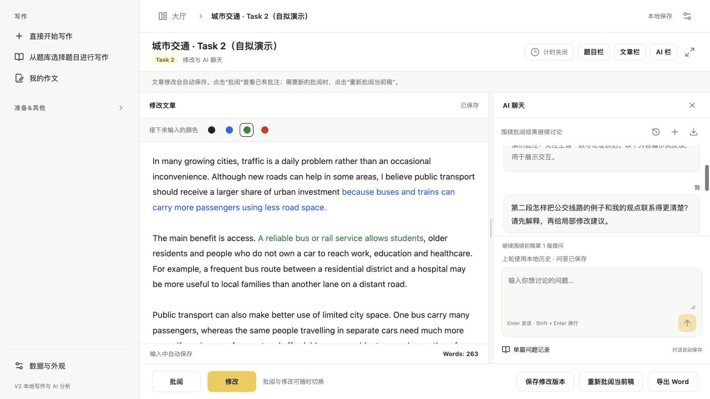
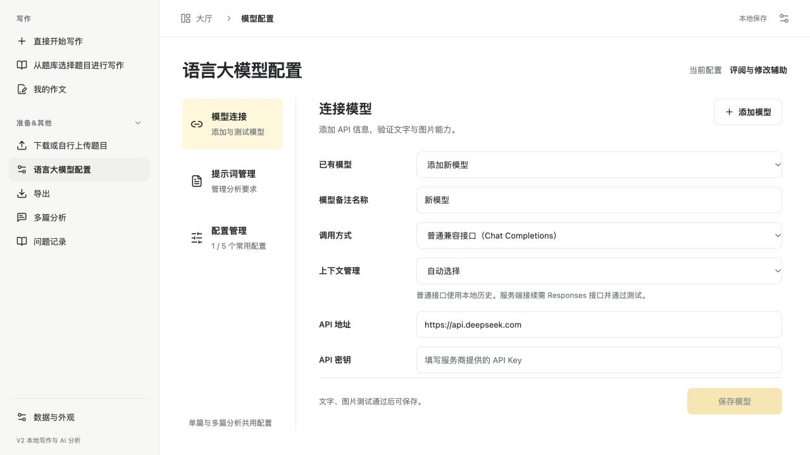
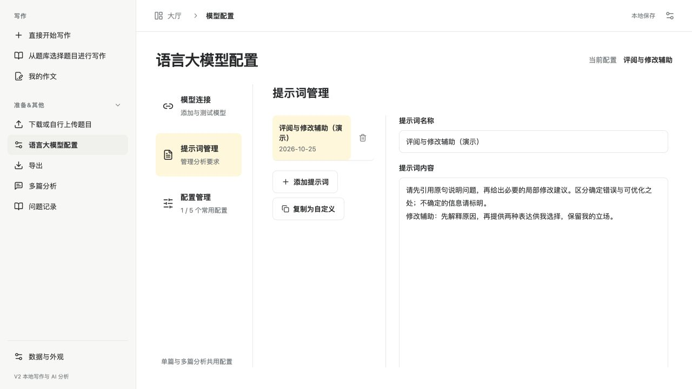

# 爱雅思写作使用指南

2026-10-25 更新 · 对应“写作 → 批阅 → 修改与 AI 聊天”流程

## 1. 数据目录与题目

第一次启动，选择一个长期保存的目录，例如“文稿/雅思写作”。应用名称为“爱雅思写作 aiELTS Writing”；已有用户无需为改名手动搬动既有数据目录。安装与首次打开见[安装说明](INSTALL.md)。

- 点击“直接开始写作”，输入第一个字符后才创建作文文件。
- 在“准备&其他 → 下载或自行上传题目”导入 PNG、JPEG、WebP，确认标题和 Task 类型，再从题库开始练习。可先从 [GitHub 下载题包](downloads/README.md)，解压后批量选择 `images/` 内的 PNG；应用内的在线自动下载尚未接入，不能直接导入 ZIP 或 PDF。
- 点击“我的作文”继续已有稿件。题目导入后会复制到数据目录，已有作文保留各自的题目快照。

迁移目录时使用“数据与外观 → 选择迁移目标… → 复制校验并切换”，先完成保存和 AI 任务；原目录会保留。不要将临时目录当作日常存档位置。

## 2. 写作页：先完成文章

题目与正文并排，支持调整栏宽、隐藏题目和全屏。实时显示字数，计时默认关闭；Task 1 可开启 20 分钟、Task 2 可开启 40 分钟，超时仍可继续写。

写作区关闭可控的拼写检查、自动更正、自动补全和系统行内预测，正常输入法候选保留。内容自动保存；页面底部的“修改”在首次批阅成功前禁用。

## 3. 点击“批阅”：保存、固定、送审

先启用可用模型配置，然后直接点击写作页底部“批阅”。应用会等待正文保存完成，再固定本次送审稿并发起批阅，不需要另找“固定初稿”按钮。

保存失败时先解决错误再提交；批阅中可以查看进度、停止或在失败后重试。尚未成功生成批注时，“修改”保持禁用。

批阅完成后自动显示：

- 左侧：与这份报告对应的只读固定原文，题目原图默认折叠。
- 右侧：批注卡片，包含原文、局部改句和解释；支持教学预估，内容取决于模型实际返回。
- 点击卡片定位原句，点击原文标记定位卡片；选中时显示高亮与删改对照。无法可靠定位的内容会说明情况，不把猜测当成精确位置。

旧报告没有结构化批注时不会自动变成精确标注。旧文字报告、问答与导出仍保留；需要新的批注时，按当前页面的“批阅”或“重新批阅当前稿”操作。

## 4. 点击“修改”：编辑与追问

成功批阅后点击“修改”，进入左侧文章编辑、右侧 AI 聊天的独立页面。首次进入会创建独立修改稿；若已有正在修改的稿件，则继续那份草稿。

- 选择黑、蓝、绿、红色后，颜色只影响之后新输入的文字。
- 修改自动保存；点击“保存修改版本”将当前稿固定为新版本。
- “批阅”查看已有报告，“修改”返回编辑；切换不重复请求模型，也不自动固定正在编辑的修改稿。
- 点击“重新批阅当前稿”才保存、固定并发起新的评阅，原稿和旧报告继续保留。

批阅卡片里的红色删除线、绿色新增文字是建议对照；编辑区的四色笔迹由你自己选择。

## 5. 与 AI 继续讨论

修改页会附上本次批阅摘要，完整批注在批阅页查看。可以围绕原文、某条建议或下一步修改提问：

> 请解释这条修改建议为什么成立，并引用对应原句。

> 这一段的例子怎样更清楚地支持主题句？请先说明逻辑，再给局部建议。

> 保留我的立场和表达风格，给我两种修改方向，先不要重写全文。

Enter 发送，Shift + Enter 换行。支持历史、新对话、单篇问题记录与导出。已有对话继续绑定原来的固定作文版本；在修改页打字不会自动把未送审文字替换进旧对话，需要针对新稿反馈时使用“重新批阅当前稿”。

后续问答使用当前启用的模型与提示词配置；更换配置后留意回复条件的变化。

## 6. 分类配置模型与 Prompt

[v2 Prompt 包](downloads/README.md#prompt-包)包含可复制的默认补充 Prompt、通用前置规则、Academic Task 1 专项和结构化批注协议。后三项已由程序自动加入，普通使用者只需在界面填写补充要求。

打开“准备&其他 → 语言大模型配置”，左侧有三个分类，右侧内容可以独立滚动，切换分类保留未保存输入。

1. **模型连接**：填写接口、API Key、模型名，选择服务商实际支持的调用方式；获取模型列表或手动填写，完成文字与图片测试后保存。
2. **提示词管理**：查看内置提示词，复制为自定义，或添加自己的评阅、修改辅助要求。
3. **配置管理**：把模型与提示词搭配，保存并启用。最多保留五组常用配置。

应用自动附上批阅前置规则及适用的 Academic Task 1 专项要求。你分享或编写的 Prompt 可以补充反馈语言、重点和修改方式；当前没有独立的“评阅专属 / 修改专属”双套配置开关，可以按用途命名并切换现有配置。

**欢迎大家提供优秀的评阅或辅助修改 Prompt。** 使用中的提示词可通过仓库 Issue 分享；若方便，附上适用任务、模型、匿名输入及效果示例，帮助其他人理解使用条件。

## 7. 调用方式与上下文管理

- **普通兼容接口**：每轮使用本地完整历史。
- **Responses 接口**：仅在服务商实际提供时选择；接口格式本身不代表支持服务端历史。
- **自动选择**：接续测试验证通过时可用服务端历史，未确认时继续使用本地完整历史。
- **本地管理**：始终提交完整历史。
- **必须使用服务端接续**：需要相应能力验证通过；远端状态过期或被拒绝时可能报错，需要按提示处理。

上下文接续测试会调用两次模型，仅使用随机测试信息，不包含个人作文。每个对话分别管理状态；切换连接或提示词时会依据本地记录重新建立上下文。两种方式都保留本地问答和导出，不保证节省费用。

## 8. 失败、恢复与导出

| 情况 | 怎样处理 |
| --- | --- |
| 配置或能力测试失败 | 检查接口、Key、模型名及图片能力，不向公开 Issue 提供 Key |
| 批阅失败或停止 | 在原任务上重试，成功生成批注前不能进入修改页 |
| 上次模型调用结果未确认 | 按界面提示决定是否重新发送，原请求可能已经计费 |
| 回复已收到，等待保存 | 使用“恢复已收到的回复”，此操作保存已有结果，不再次请求模型 |
| 上下文预算不足 | 按提示调整预算或输入范围，应用不会悄悄截断作文 |

在“准备&其他 → 导出”选择已固定版本，导出保留笔迹颜色的 `.docx`。批阅与聊天可通过相应记录的导出入口选择 Markdown 或 Word；题目图片不随 Word 文档导出。

多篇分析需要自行选择每篇作文的固定版本，报告保留来源。删除内容先进入数据目录的“回收站”，可从“数据与外观”打开；删除题库题目不移除已有作文的题目快照。

截图说明：使用当前应用组件、自拟题目和合成批注/聊天，展示流程，未调用真实模型。浏览器普通入口仅为交互原型；完整导入、AI 和导出使用桌面版。
